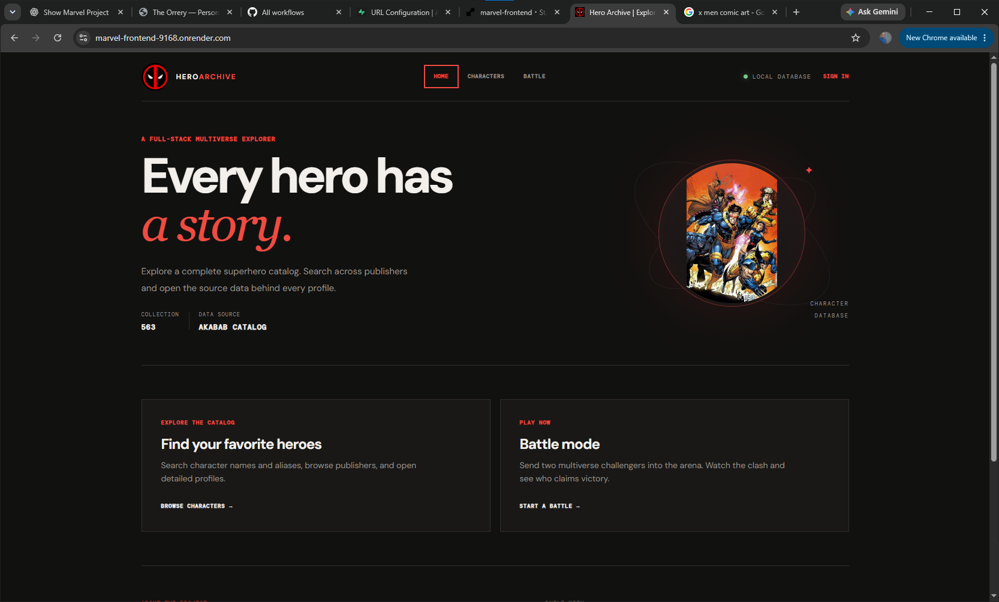
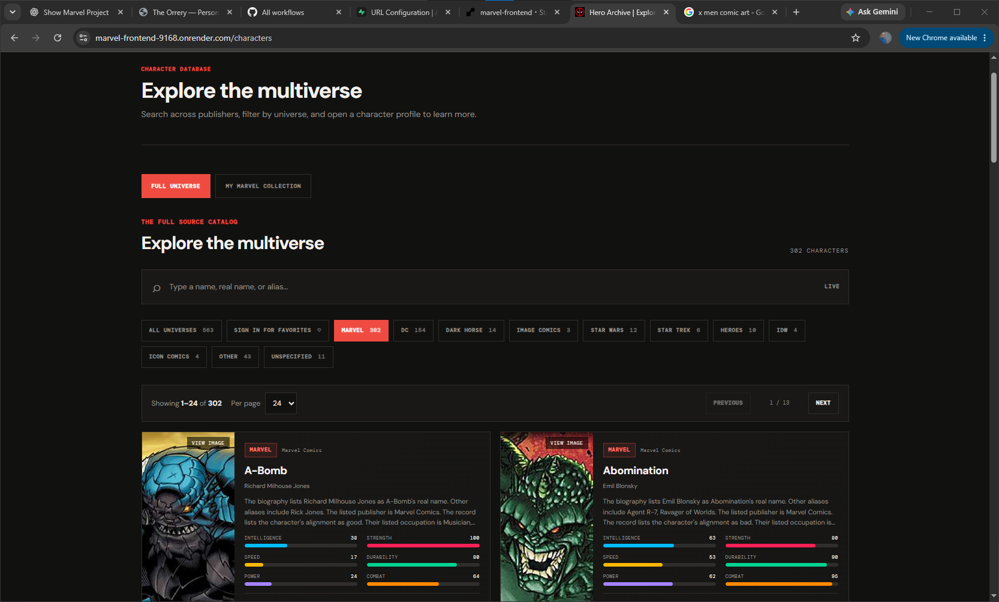
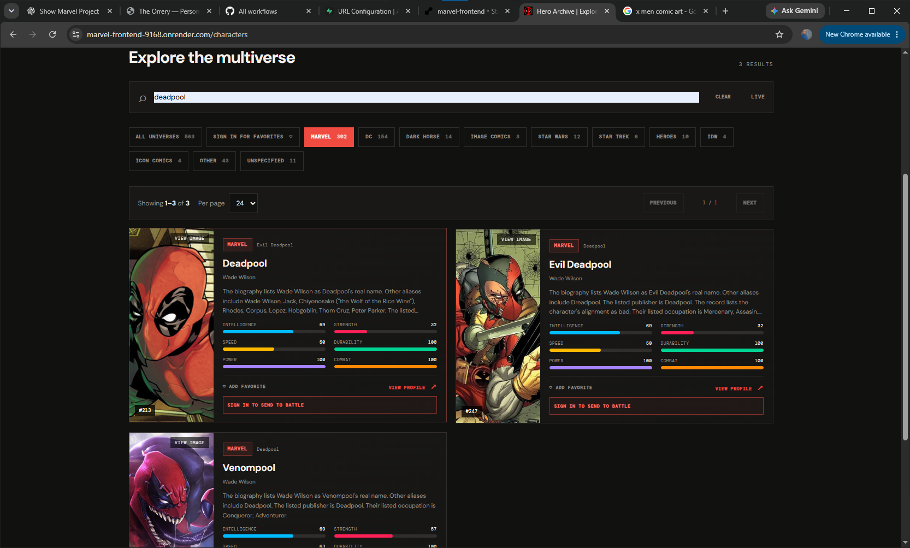
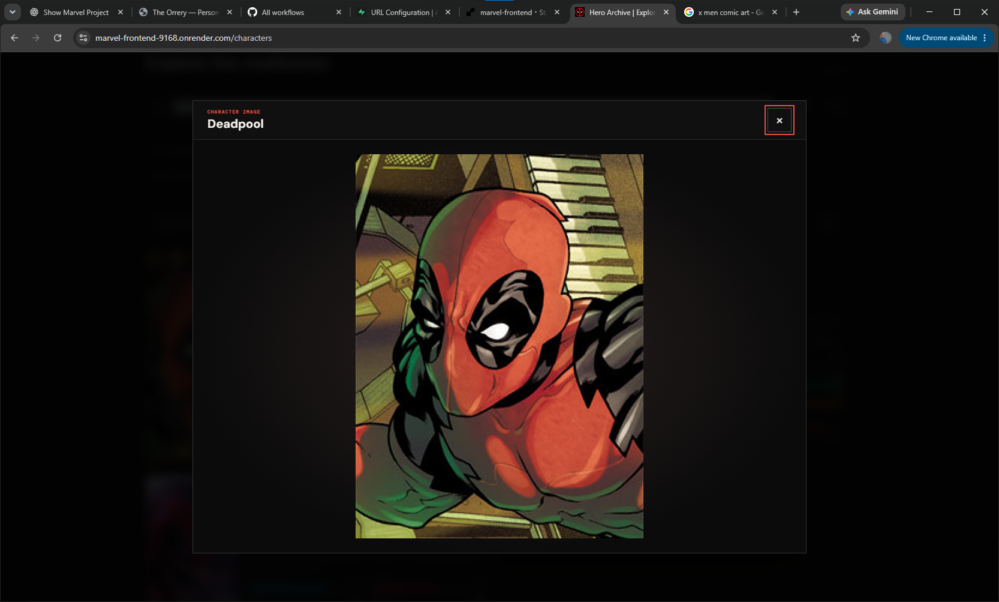
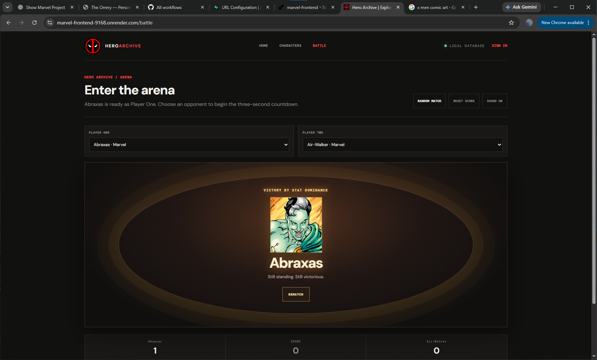
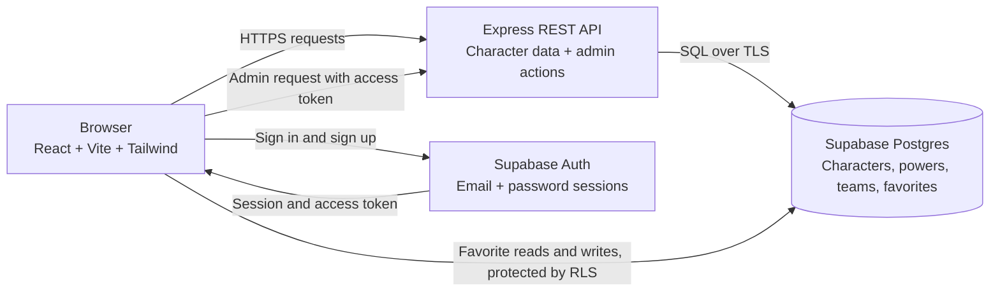

# Hero Archive

Hero Archive is a full-stack multiverse character catalog built as a developer portfolio project. Browse characters from multiple publishers, search by name or alias, open detailed profiles, save favorites, and send a chosen character into Battle mode.

## Screenshots

### Homepage



### Character catalog



### Live character search



### Character image preview



### Battle mode



## Features

- Search the full catalog by character name, real name, or alias.
- Filter characters by universe or publisher.
- Open character profiles with biography, appearance, work, connections, and color-coded power-stat bars.
- Enlarge a character image in an accessible preview modal; use a local illustration when a record has no working image URL.
- Explore the source catalog separately from the curated Marvel collection.
- Create an account and save favorites with Supabase Auth.
- Sign in to send a character from the catalog to Battle mode.
- Play a cinematic one-on-one battle with a countdown, card clash, synthesized sound effects, a winner screen, and a result based on all six power stats.
- Manage the curated Marvel collection through the administrator page.

## Tech stack

- React and Vite for the frontend
- Tailwind CSS for styling
- Node.js and Express for the API
- Supabase Postgres for character data and favorites
- Supabase Auth for user accounts

## Architecture

The browser uses the Express API for character data and administrator actions. Supabase Auth manages sign-in, while the browser accesses each user's favorites under the database's row-level security policies.



## Run locally

The frontend depends on the API in the separate [marvel-backend repository](https://github.com/LordInfamous86/marvel-backend). Start the backend first and follow its README to configure the database, import the full universe dataset, and grant administrator access if needed.

1. Clone this repository and enter the project directory:

   ```sh
   git clone https://github.com/LordInfamous86/marvel-frontend.git
   cd marvel-frontend
   ```

2. Copy the example environment file:

   ```sh
   cp .env.example .env.local
   ```

3. In `.env.local`, add the Supabase Project URL and publishable key from **Project Settings → API Keys**. `VITE_API_URL` should point to the backend, usually `http://localhost:5000`.
4. Install dependencies and start the frontend:

   ```sh
   npm install
   npm run dev
   ```

5. Open the local address Vite prints, usually `http://localhost:5173`.

Vite reads environment variables when it starts, so restart the frontend after changing `.env.local`.

## Accounts and favorites

The app uses Supabase Auth for email and password sign-up and sign-in. Configure the local site URL and redirect URL as `http://localhost:5173` in Supabase **Authentication → URL Configuration**. Before using favorites, run `database-migration-favorites.sql` from the backend project in the Supabase SQL Editor. Row Level Security policies restrict each account to its own favorites.

The Supabase publishable key is intended for browser use. Never put a database password or secret/service-role key in this frontend project. Keep `.env.local` private; it is ignored by Git.

## Data source

The full catalog is imported from the [Akabab Superhero API](https://github.com/akabab/superhero-api). Character records and image URLs are displayed with source attribution. Superhero characters and their artwork belong to their respective rights holders; this fan-made portfolio project is not affiliated with them. Confirm image and data permissions before public or commercial use.
